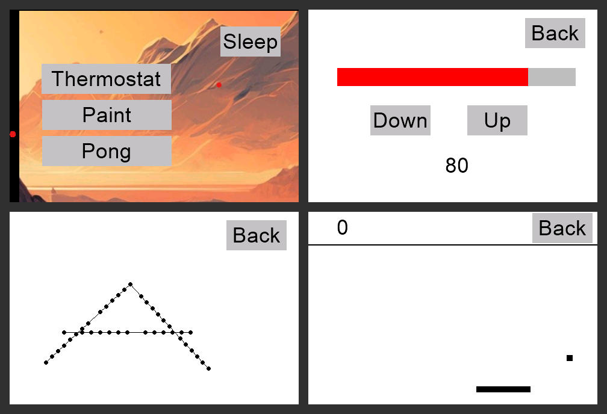

# nextion-tools

Tools for [Nextion](https://nextion.tech) HMI displays: the Nextion Editor's project files, the
TFTs it compiles, and an emulator of the display itself for testing the firmware that drives one.

## Try it

```
git clone https://github.com/jamesmulcahy/nextion-tools
cd nextion-tools
pip install -e ".[images]"
python demo/run.py
```

Then open http://127.0.0.1:8080/ and use the panel with your mouse.



That is an emulated Nextion display running a project made in the Nextion Editor
(`demo/demo.HMI`), with its own touch handling, scripts and timers, and a small Python program
(`demo/companion.py`) as the microcontroller behind it: the menu's buttons change page, the
thermostat's bar turns red near the top, Paint draws where you drag, and Pong plays against a
paddle that follows the pointer. The same companion drives a real display flashed with
`demo/demo.tft`. See [The demo](#the-demo) and [demo/README.md](https://github.com/jamesmulcahy/nextion-tools/blob/main/demo/README.md).

| Module | What |
|---|---|
| `nextion_tools.hmi` | `.HMI` projects: pages, components, ids, geometry, attributes, event code, `Program.s`; numeric edits with re-stamping |
| `nextion_tools.fonts` | `.zi` fonts: metrics and glyph bitmaps, and which font a component's `font` index means |
| `nextion_tools.images` | pictures as RGB arrays, and the panel's RGB565 |
| `nextion_tools.tft` | a compiled `.tft`: its picture table, checksums and orientation, and same-size picture swaps |
| `nextion_tools.crc` | the CRC behind TFT checksums and HMI page stamps |
| `nextion_tools.render` | draws a page as the display shows it, from the HMI and the values its components hold |
| `nextion_tools.emu` | an emulated display, driven by the project's HMI (below) |

```
pip install nextion-tools            # hmi, tft, crc and the emulator: no dependencies
pip install nextion-tools[images]    # fonts, pictures, rendering and the viewer: numpy and Pillow
pip install nextion-tools[serial]    # the emulator on a real serial port: pyserial
```

```python
from nextion_tools.hmi import Project

project = Project.load("gui.HMI")
home = project.page("home")                 # KeyError if there is none; find_page() gives None
print(home.id, [(c.id, c.name, c.kind, c.rect) for c in home.components])
print(home.component("tm0").events["timer"])
print(project.program)                      # Program.s, line by line
```

The format notes are in the module docstrings, and were checked against files the Editor saved.

## The demo

`demo/` holds a small project made in the Nextion Editor (`demo.HMI`, and `demo.tft` compiled
from it) and `companion.py`, a Python program that plays the MCU. `python demo/run.py` runs the
whole thing (the emulated display, the companion and the browser viewer) in one process, and
takes `--http PORT` and `--rotation 90` (the screen as the LCD itself holds it).
`python demo/companion.py --serial /dev/ttyUSB0 --fps 8` drives a real display running
`demo.tft`, which needs the `serial` extra. [demo/README.md](https://github.com/jamesmulcahy/nextion-tools/blob/main/demo/README.md) has what each page does and what
the project turned up.
Nextion and the Nextion Editor are ITEAD's; this project is not affiliated with them.

## The emulator

An emulated Nextion HMI display, for testing the firmware that drives one. Point the MCU's UART
at it (QEMU's `-serial tcp:`, a pty, or a real serial port). It executes what it is sent, keeps a
model of what the screen would show, replies as a real display does, and lets a test act as the
user.

```python
from nextion_tools.emu import Display, TcpServer
from nextion_tools.hmi import Project

display = Display(TcpServer(port=4000), hmi=Project.load("gui.HMI"))  # qemu ... -serial tcp:127.0.0.1:4000
display.wait_for_page("home")
display.press("h_ceiling")                  # a finger on it, by name or id: display.press(22)
display.wait_for_value("home.room.txt", "Kitchen")
assert not display.errors                   # nothing the display would have rejected
```

Or from a shell, to watch what firmware sends:

```
python -m nextion_tools.emu --tcp 4000
python -m nextion_tools.emu --pty                 # prints /dev/pts/N
python -m nextion_tools.emu --serial /dev/ttyUSB0 # needs pyserial: pip install nextion-tools[serial]
python -m nextion_tools.emu --tcp 4000 --hmi gui.HMI   # with the project's pages and code
python -m nextion_tools.emu.script gui.HMI        # can every event of this HMI be run?
```

## What it models

Replies follow what an NX4832F035 (the Sonoff NSPanel's display, US and EU) was measured to do, which differs
from Nextion's documentation in places:

| Instruction | `bkcmd=3` | `bkcmd=0` |
|---|---|---|
| assignment | `01` | nothing |
| `get x` | `71` + 4 bytes (or `70` + text), **no** `01` | the same |
| `printh …` | the bytes, **no** `01` | the same |
| unknown component, variable, or bad syntax | `1a` (never `02`/`1b`) | nothing |
| `page` / `ref` | `01` at once, then the redraw blocks the next instruction ~400 ms | — |
| `delay=N` | `01` when it ends | — |

`bkcmd` starts at 2, as on a display that has just powered on, and `power_cycle()` puts it back.

**Ideal or flow model.** By default every instruction executes the moment it arrives, so tests
see exactly what the firmware meant to draw. With `flow_model=True` the display behaves as the
real one does:

- input arrives at line rate (QEMU's UART does not pace writes);
- it waits in a buffer of 1088 bytes;
- the display stalls on page changes, `ref` and `delay`;
- a burst that overruns the buffer during a stall loses commands (`display.lost`), and the
  display sends `0x24` when it resumes.

`tests/emu/test_calibration.py` replays the hardware measurements against the model, so it cannot
drift from them unnoticed.

**TFT uploads** (`whmi-wri`, `whmi-wris`): the display acknowledges 4096-byte chunks, answers
v1.2's first chunk with a jump, and keeps the image in `display.flash`. It can be told to
misbehave: slow, dropped or duplicated acks, jumps, stray bytes, a power cycle mid-upload.

**The HMI.** Given the project (`hmi=Project.load(...)`, read straight from the Nextion Editor's
`.HMI`), the display knows what exists and resolves names as the real one does:

- `comp.attr` without a page means the current page;
- `page.comp.attr` reaches another page only for a global component;
- the attribute must be one the component has, and a literal must suit it (text or number);
- page and component ids, for `page N` and touch events, are the HMI's;
- `get` answers the HMI's value for anything not yet assigned (`display.value(key)`);
- loading a page resets its local components;
- the display starts on page 0.

Anything that does not resolve fails with `1a` and is recorded in `display.errors`. On a real
display running `bkcmd=0`, that is a label that is silently never drawn. Without an HMI every
name is accepted. `resolver=` overrides the HMI with a function of your own.

**The TFT's own code.** With an HMI, the display also runs the code in it (`emu/script.py`):

- `Program.s` at `boot()`: its globals, then `page 0`, whose load code may print a banner;
- each page's `unload`, `load` and `loadend` on a page change, whoever asked for it;
- the current page's timers, every `tim` ms while `en` is set, on the display's clock;
- touches. `touch_down(x, y)` / `touch_move` / `touch_up` are a finger on the screen, and
  `press(name)`, `slide(name, value)`, `drag`, `swipe` and `tap` are built on them. The touch
  lands on the visible component drawn last at that point (else the page). It sends the 0x65
  edges the component's `sendkey` asks for, then runs the component's `down` / `up` (and a
  slider's `slide`), then the page's touch capture's, with `tch0..3` and the capture's `val`
  set as the display sets them. With `sendxy=1` each press and release is also reported with
  its coordinates (0x67).
- sleep: with `sleep=1` the screen is dark and touches reach nothing; with `thup=1` the first
  one wakes the display (0x87) and is used up doing it.

All of an HMI's code is compiled when the display loads it, and code outside what the
interpreter supports is refused then (`UnsupportedCode`, naming the event and line).
`python -m nextion_tools.emu.script gui.HMI` lists what an HMI uses and what it cannot run. An override
(`overrides={"page.component.event": fn}`, logged at startup) runs Python instead of an event's
code; `scripts=False` turns the code off, and touches are then bare 0x65 frames
(`send_touch_event`). A statement that fails when it runs (an unknown name, say) is reported as
an instruction would be (`1a`, `display.errors`, `display.script_errors`), and the code carries on.

For tests that need timers to fire exactly, pass `clock=ManualClock()`, then `clock.advance(s)`
and `display.tick()`. `expire_timer(name)` runs a timer out now, whatever the clock.

Observed on a real NSPanel: assigning `en=1` to a running timer restarts its countdown (tapping
keeps NSPanel Manager's screensaver off, and each tap runs `sleep_display.en=1`). The Editor's
Debug simulator does not restart it, so it is not a guide to this. Assigning `tim` restarts it
too, which is not observed either way.

Not measured on hardware yet, so each is a choice (see `emu/script.py` and `display.py`):

- the order on a touch: the 0x65 frame, then the component's code, then the touch capture's;
- `&&` and `||` stop at the first operand that decides; a failed condition skips its `if`;
- an expression mixing `+`/`-` with `*`/`/` is refused, since precedence is not known;
- `page` ends the event that ran it;
- a slider's value is linear in the touch position, ignoring the thumb's width;
- whether a failed statement in event code sends `1a` at `bkcmd` 2 and 3 (assumed yes);
- `sendxy` and sleep follow Nextion's instruction set: 0x67 on press and release only (whether
  a drag streams them is not known), its order before the 0x65 frame, and the waking touch
  going nowhere.

**What the screen shows.** `display.snapshot()` draws the current page as a numpy array, and
`display.save_png(path)` saves it (both need `[images]`). They draw from the HMI and what the
display holds now: pictures, crop pictures, text in the HMI's own fonts, buttons in their
pressed or second state, sliders, progress bars, hidden components left out, and the drawing
instructions sent since the page was shown (`fill`, `cls`, `pic`, `xstr`, `line`, `draw`,
`cir`, `cirs`). A sleeping display is black. See `render.py` for what is and is not drawn.

**In a browser.** `python -m nextion_tools.emu.viewer --hmi gui.HMI --tcp 4000` runs a display
and serves it on http://127.0.0.1:8080/. A press on the screen is a finger going down there, a
drag moves it, and the side panel shows the page, the last instructions, rejected ones, and the
input buffer when the flow model is on. `Viewer(display)` attaches one to a display a test or rig
already has.

**Orientation.** A page's coordinates are the view of someone looking at a panel mounted as its
TFT intends (NSPanel's US pages are 320 x 480, its EU pages 480 x 320), and touches use the same
frame, so pictures and the viewer are upright by default. `Display(rotation=90)` turns snapshots
and the viewer clockwise, and maps clicks back, to show a panel as it actually hangs.
`render.native_rotation(tft.orientation(data))` gives the rotation that shows the LCD's own
frame, the one a TFT stores its pictures in: a TFT made at 90 holds them turned 90 degrees
clockwise (`demo/demo.tft`). `Project.direction` is the same setting, read from the HMI.
Fonts from recent Editors are stored turned that way too, and are read upright.

## The terminal (protocol 8)

[nspanel-terminal](https://github.com/ptaru/nspanel-terminal) is a TFT for the NSPanel's display
whose native code adds a pixel receiver: the MCU renders with LVGL and streams RGB565 rectangles
at 4 Mbaud instead of sending Nextion instructions. `Display(terminal="us")` (or `"eu"`,
`"eu-on-us"`, or a `TerminalProfile`) runs that TFT, so firmware that draws through it can be
tested the same way:

```python
from nextion_tools.emu import Display, TcpServer

display = Display(TcpServer(port=4000), terminal="us", rotation=180)
display.wait_for_terminal()           # the firmware started a session
display.wait_for_rectangles(1)
display.terminal_image().save("screen.png")   # the framebuffer, turned by `rotation` (needs [images])
display.tap(*display.unrotate(160, 240))      # a touch where the picture shows (160, 240)
assert not display.terminal.faults
```

| Profile | Receiver area | Touch reports | For |
|---|---|---|---|
| `us` | 320 x 480 | drawing coordinates | `terminal-us.tft` on a US panel |
| `eu` | 454 x 320 | drawing coordinates | `terminal-eu.tft` on an EU panel |
| `eu-on-us` | 454 x 320 | x - 26 | `terminal-eu.tft` on a US panel, whose touch controller counts all 480 lines |

The EU controller has 480 columns, of which the receiver reaches 454; the framebuffer is the
receiver's area, and a rectangle beyond it is refused, as on the display.

What it models, from nspanel-terminal's [protocol](https://github.com/ptaru/nspanel-terminal/blob/main/docs/PROTOCOL.md)
and its display-side source (`firmware/src/stream_protocol.h`, `terminal_receiver.c`):

- **Command mode**, before and after a session: `connect` reports native version 94 (stock TFTs
  report 72), and `touch_j` with `sys0` = 2000000 or 4000000, `sys1` = 0 or 1 (touch polling) and
  `sys2` = a nonzero session id starts a session. The receiver answers READY_BRIGHTNESS (134)
  50 ms later. Other values, or `touch_j` on a stock TFT, start nothing.
- **Records**: COBS frames of a 20-byte header (CRC16) and up to 512 body bytes: RECT, DATA
  (PackBits RGB565, high byte first), END (x=1 ends a burst: DONE), PING, EXIT (BYE), SYNC
  (SYNCED), BRIGHTNESS (BRIGHTNESS_DONE, and `system["dim"]`). Every check the receiver makes
  (session, sequence, geometry, body length, PackBits runs, pixel count, COBS structure, 535
  encoded bytes) faults the same way: one ERROR, then nothing until a SYNC.
- **Reports**: 32 bytes, on every event, after every 256 bytes consumed, and per touch sample.
- **Credits**: more than 512 bytes beyond the last report the sender could have seen is a
  credit violation (ERROR, flag 0x1000): the session ends.
- **Watchdog**: 3 s without input ends the session (ERROR, flag 0x2000), on the display's clock
  (`ManualClock` and `tick()` work as for timers).
- **Touch**: during a session `touch_down`/`touch_move`/`touch_up`, `tap`, `drag` and `swipe`
  take the receiver's drawing coordinates and send touch samples (mask, signed x, y), if `sys1=1`.
- **The end**: after BYE or a fatal error the display is back in command mode at 115200 and
  sends `A9 FF FF FF`, as the TFT's patched `touch_j` continuation does. `power_cycle()` ends a
  session silently and clears the screen.

`display.terminal` is the session's `Receiver` (records by kind, `faults`, `reports`,
`rectangles`, `brightness`); `framebuffer`, `terminal_rgb565()`, `terminal_pixel(x, y)`,
`terminal_snapshot()` and `snapshot()` show what it drew, and the viewer shows it too
(`python -m nextion_tools.emu.viewer --terminal us --tcp 4000`). `terminal.Receiver` also works on
its own, and `terminal.encode_record`, `packbits_encode` and `parse_report` speak the protocol
from the MCU's side.

Choices the documentation leaves open, so each is the emulator's (see `emu/terminal.py`):

- the display consumes bytes as they arrive, so its ring never fills; the credit rule is checked
  as stated instead, which a conforming sender never trips;
- pixels land when a record's delimiter arrives, not byte by byte (the end result is the same);
- a touch sample is reported once; other reports carry the mask and position, freshness 0;
- `A9 FF FF FF` is sent after every return to the stock runtime, including a refused `touch_j`;
- sys0..sys2, `bkcmd` and the page are left as they were after a session.

The receiver is checked against golden vectors made by the real sender and decoder
(`tests/emu/terminal_vectors/`, regenerated by its `generate.sh`), and live against the real
sender (`tests/emu/test_terminal_live.py`). Parts of `emu/terminal.py` are ported from
nspanel-terminal, MIT licensed, Copyright (c) 2026 NSPanel public contributors; its notice is in
that file.

## Not modelled (yet)

- **Pixel-exact rendering.** Pictures and glyphs are exact; borders, the Editor's compressed
  pictures (drawn from the file they were imported from) and some component types are not.
- **Drawing instructions** in event code (`xstr`, `fill`, ...) and `click`, `tsw`, loops: the
  HMIs tested do not use them, so they are refused rather than guessed at.

## Tests

```
pip install -e ".[images,serial,test]"
python -m pytest
```

Most tests build small projects in code (`tests/hmi_builder.py`), and some use the demo's
files, which the Editor made. The rest need NSPanel Manager's project and TFT, and are skipped
unless given them:

```
NEXTION_TOOLS_HMI=path/to/gui.HMI NEXTION_TOOLS_TFT=path/to/gui.tft python -m pytest
```

The terminal's live test builds the real protocol-8 sender, so it needs a C++ compiler and the
sender's source: `NSPANEL_TERMINAL=path/to/nspanel-terminal` (or
`NEXTION_TERMINAL=path/to/firmware/lib/NextionTerminal`). The golden vectors it uses otherwise are
committed; `tests/emu/terminal_vectors/generate.sh` makes them again from those sources.

## License

MIT; see [LICENSE](https://github.com/jamesmulcahy/nextion-tools/blob/main/LICENSE). The terminal
receiver (`emu/terminal.py`) is partly ported from nspanel-terminal, also MIT (Copyright (c) 2026
NSPanel public contributors); its notice is kept in that file.
